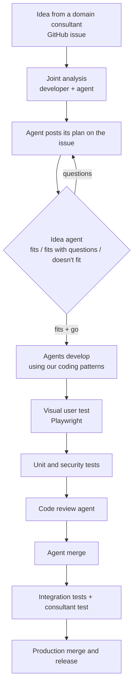

# Agentic delivery playbook

This repo shows how I run development with agents. The basic principle: agents do the coding, and I focus on the big decisions and the big picture.

It's my job to make sure the agents understand what I want built and why, and to set up checks that run to ensure the quality of the work the agents deliver.

The repo is split into a few sections to show my ideas working:

- A [demo](demo/) of real GitHub issues about a made-up app.
- A [plan reviewer](reviewer/), a small version of my idea agent written for this repo, that gives the verdicts on the [demo issues](https://github.com/Henry-Stonell/agentic-delivery-playbook/issues?q=label%3Ademo).
- A [guard](docs/04-the-guard.md) that makes the review more than a suggestion, written out as a [template](templates/guard.md) of its rules and test cases.

The full setup isn't here. This is a short demo. If you only read one page, read [two reviews you can open](docs/07-demo-reviews.md). It shows the plan review running on issues anyone can open.

I no longer review every line of code myself, which might sound scary to some developers. But in my eyes, development has moved past that point. We have an extremely powerful tool that can be used to write code much faster, and my job now is to utilise that tool and make it safe and trustworthy. I need to make sure my tools understand the task properly, and judge whether a change is worth making or goes against our goals.

It doesn't matter much what language the code is in. That's how I moved from AL to TypeScript: the agents know the language, and my job is to give them what they need to write what I want.

Tests, a visual check and a code review agent check the code. I check the decisions. That's where my ERP background helps: I can tell when a change would break the data model or the system around it.

My most important thought: "Building the wrong thing ALWAYS costs more than an expensive, in-depth review beforehand." The most important check happens before any code is written.

## The chain

Each step has to pass before the next one starts. Today the plan review runs on its own, and a guard makes its go binding. The other steps run inside each development session. Until a planned merge check enforces the order at the pull request, the later steps follow the written rule. [Page 2](docs/02-quality-chain.md#what-runs-today) shows what is built and what is planned. There are two ways around the order: an urgent fix, and work on the idea agent itself. In both cases I write the decision down and own it.

## What's in this repo

| Part | Where |
|---|---|
| The quality chain, step by step | [Page 2](docs/02-quality-chain.md) |
| A demo: a made-up app with real GitHub issues, plans and verdicts | [demo](demo/), [page 7](docs/07-demo-reviews.md) |
| A plan reviewer, a cut-down version of the idea agent, with its test results | [reviewer](reviewer/), [page 8](docs/08-results.md) |
| The guard: why a go has to be binding, and the rules and test cases to build your own | [Page 4](docs/04-the-guard.md), [template](templates/guard.md) |
| Templates to start your own | [templates](templates/) |

## Principles

1. Check the idea before the code.
2. No agent starts without an explicit go. Exceptions are written down and owned by a person.
3. A rule in a prompt is guidance. Whatever must never be skipped gets a guard.
4. The checker is never the maker.
5. Keep the constitution short. Agents never change it.
6. Everyone is responsible for their agents. Claude is my tool, but it is my code.
7. Someone has to say go. Don't review forever.
8. Choose models on purpose. Cheap models read, strong models think and review.
9. Watch the gates themselves.

## Pages

1. [The problem](docs/01-the-problem.md)
2. [The quality chain](docs/02-quality-chain.md)
3. [The idea agent](docs/03-idea-agent.md)
4. [The guard](docs/04-the-guard.md)
5. [The constitution](docs/05-constitution.md)
6. [What broke, and what I learned](docs/06-lessons.md)
7. [Two reviews you can open](docs/07-demo-reviews.md)
8. [Results from real runs](docs/08-results.md)

Templates to start your own: [constitution](templates/constitution.md), [plan](templates/plan.md), [idea agent brief](templates/idea-agent-brief.md), [guard rules and test cases](templates/guard.md).

## About

I come from ERP development (Business Central, AL) and now run AI-first development of internal web apps.

Contact: [LinkedIn](https://www.linkedin.com/in/henry-stonell-63b8b4244)

Claude turned my answers from a long interview into this text, and I checked every page. The ideas and the decisions are mine.

Text and templates © 2026 Henry Stonell, licensed under [CC BY 4.0](LICENSE). You may share and adapt them if you credit me. The code in [reviewer](reviewer/) is under the MIT licence.
