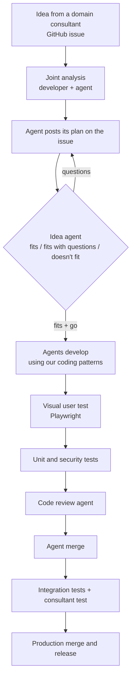

# Agentic delivery playbook

How I lead development when AI agents write almost all of the code.

I own the development of a monorepo of internal web apps for a small team. The agents write the code. I decide what gets built, make sure the agents understand it before they start, and set up the checks every change has to pass before production.

There is no code here on purpose. I didn't want to invent an app just to show this. What I can share is how the work is organised, the rules, and what went wrong. Everything is generalised, so nothing from my employer is in here.

Building the wrong thing always costs more than reviewing the plan first. So the most important check happens before any code is written.

## The chain

Each step has to pass before the next one starts. Today a guard enforces this at the first gate, on one app. The later steps follow the written rule until a merge check enforces it at the pull request. The only way around the order is an urgent fix, and then I write the decision down and own it.

## What is live

Status in November 2026:

| Part | Status |
|---|---|
| Idea agent: reviews the plan before any code | Live, on one app |
| Guard: refuses pushes and pull requests without the idea agent's go | Live, on one app |
| Constitution: a short no-go list every agent follows | Live |
| Rule: bring the branch up to date before starting work | Live |
| The rest of the chain as agent routines | Being built |
| A routine that checks the gates are on and running | Being built |
| Merge check that refuses anything that skipped a step | Planned |
| Escalation of issues nobody has touched for a while | Planned |

I don't have numbers yet. The idea agent logs what changed after each review, and we will evaluate it properly later. What I can say is that it's better than before, when nobody checked the plan before the code.

## Principles

1. Check the idea before the code.
2. No agent starts without an explicit go. Exceptions are written down and owned by a person.
3. A rule in a prompt is guidance. Whatever must never be skipped gets a guard.
4. The checker is never the maker.
5. Keep the constitution short. Agents never change it.
6. Everyone is responsible for their agents. Claude is my tool, but it is my code.
7. Someone has to say go. Don't review forever.
8. Choose models on purpose. Cheap models read, strong models think and review.
9. Watch the gates themselves.

## Pages

1. [The problem](docs/01-the-problem.md)
2. [The quality chain](docs/02-quality-chain.md)
3. [The idea agent](docs/03-idea-agent.md)
4. [The guard](docs/04-the-guard.md)
5. [The constitution](docs/05-constitution.md)
6. [What broke, and what I learned](docs/06-lessons.md)
7. [Two real reviews](docs/07-real-reviews.md)

If you only read one page, read [two real reviews](docs/07-real-reviews.md). It shows the idea agent at work on real issues.

Templates to start your own: [constitution](templates/constitution.md), [plan](templates/plan.md), [idea agent brief](templates/idea-agent-brief.md).

## About

I come from ERP development (Microsoft Dynamics 365 Business Central, AL) and now lead AI-first development of internal web apps. I'm based near Munich and work in English and German.

I explained all of this in a long interview. Claude turned my answers into text, and I checked and corrected every page. The ideas and the decisions are mine.

Text and templates © 2026 Henry Stonell, licensed under [CC BY 4.0](LICENSE). You may share and adapt them if you credit me.
