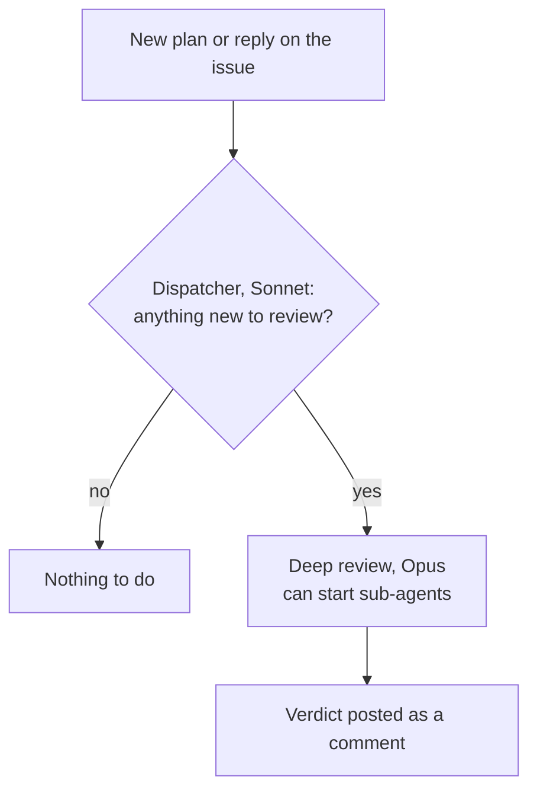

# 3. The idea agent

The idea agent is the first gate. It reviews the plan before any code is written. It runs on GitHub as a routine.

## Why it exists

Humans are the bottleneck. We can't read or write fast. What we can do is evaluate. Before the gates, one developer had to do the whole analysis alone. The idea agent takes most of that work, so the developer has time for the architecture.

## What it reads

It checks the plan against four things:

1. The request the consultant wrote.
2. The team's decision library: our decisions, collected as documents and meeting transcripts. It's its own repository today, and the idea agent has read access. We plan to move it into the monorepo.
3. The building block the task belongs to.
4. The work areas. Each consultant can own an area and write down how they want things done. An area can be marked as frozen.

## The three verdicts

| Verdict | Meaning | What happens next |
|---|---|---|
| Fits | The plan matches. | The developer can start. |
| Fits with questions | Mostly right, but some points are open. | Answer the questions. If the plan touches a frozen area, that area's owner has to approve the start. |
| Doesn't fit | The plan needs to be rethought. | Come back with a new plan. |

Everything happens on the GitHub issue. The developer's agent posts the plan. The idea agent comments below it. The developer replies, and the idea agent reads the reply.

## How a review runs

The dispatcher is cheap and only checks if something changed. The deep review runs on the strongest model. Each agent only gets the information it needs, so no extra context muddies the review.

## Not reviewing forever

This was a real problem. You can tweak a plan for hours and never start. Until something is built, there's nothing to test against. If the plan fits overall, it's better to start and fix small things later.

So someone has to decide. The developer role didn't die. We are the ones who say "go ahead, start building".

The idea agent helps too. After each round it only reviews what is new, such as the answers to its questions. When things run long, we see about six rounds before development starts.

## How we tested it

Before it went live, we gave it four test issues marked "not real work". Each plan had a mistake hidden in it on purpose. One broke a rule that keeps two parts of the app separate. Another added a database change that the parent task had ruled out.

The idea agent had to find the mistake without being told there was one. It found all four. We kept the test issues as test cases for later changes.

The test round also found a flaw in the idea agent. It asked questions but didn't suggest possible answers. Now every question comes with suggested answers.

## It never reviews itself

When I build or change the idea agent, the issue gets a hands-off label. That way the gate never reviews its own construction.
