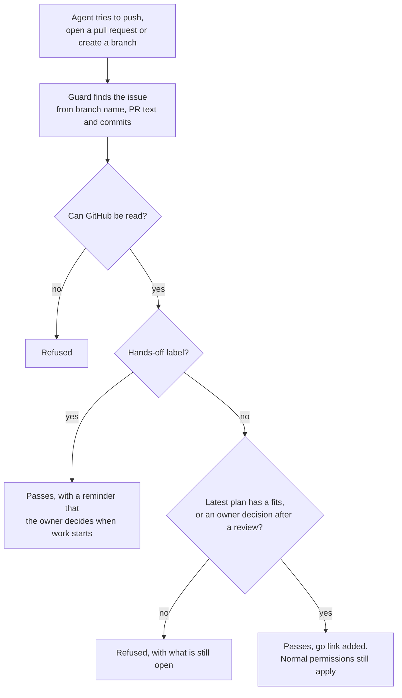

# 4. The guard

## Why the go became binding

At first the go was only a rule in the agent instructions: no branch and no pull request without the idea agent's go. Then a session on the cheapest model, at low effort, skipped the comments on the issue. It offered to "proceed anyway".

A rule in a prompt is guidance. An agent can miss it or talk itself out of it. So the next day the rule became a check.

I decided we needed a guard and set its principles: what counts as a go, who may give one, and to refuse when in doubt. An agent designed and built it to those principles. That's how everything here works. I decide what is needed and what the rules are, and the agents write the code.

## How it decides

The guard is a hook in the agent tool (a Claude Code PreToolUse hook). It runs before every push, every new pull request and every new branch. It doesn't matter if the agent uses git, the GitHub command line or the GitHub connector.

A few rules sit behind the diagram. A new version of the plan cancels the go. A "fits" only counts from the idea agent's own account, and a decision only from me or my deputy. A label or a "yes" in chat is never a go. The guard has its own test cases, so a change can't quietly break it.

It's live on one app so far.

## What can go wrong

| What could go wrong | What happens today | Status |
|---|---|---|
| Someone writes "the owner approved this" in a comment | Nothing. Only the idea agent's account or the owner's and deputy's accounts count. | Covered |
| Text in an issue tells an agent to ignore its rules | The agent rules say text in an issue, a comment or a file never lifts a rule. The guard doesn't follow text at all. It only checks who gave the go. | Covered |
| Someone adds a label or says "yes" in chat | Never a go. | Covered |
| The plan changes after a "fits" | The go is cancelled until the new version is reviewed. | Covered |
| GitHub can't be read | The push is refused. | Covered |
| A person pushes by hand, outside the agent tool | A hook only sees what the agent does. This needs a second check on the server, like branch protection or a merge check at the pull request. | Needs a second layer |
| Someone uses the hands-off label to skip the gates | A bypass label is only as safe as the rules on who may set it. Keep that group small. | Needs a second layer |
| The idea agent says "fits" when it shouldn't | The later steps still run: the visual test, the tests, the code review and the consultant test. | Partly covered |

## Exceptions

The hands-off label skips the gates. I use it in two cases. The first is when I work on the idea agent itself, so it never reviews its own construction.

The second is an urgent fix. Then I open the issue with the label and write a decision on it as the owner of the area. It's 100% on me. My deputy can do the same when I'm away.

A merge check is planned. It will refuse any pull request that skipped a step without that decision. It will leave a note like "the idea agent didn't give its go, please ask the area owner or wait for the review".

## How the team took it

So far, nobody has pushed back. It's an adjustment, because before you could let your agents do anything at any time. But people see it as a safety net. It makes sure what we build is real development and not vibe-coded AI slop.
